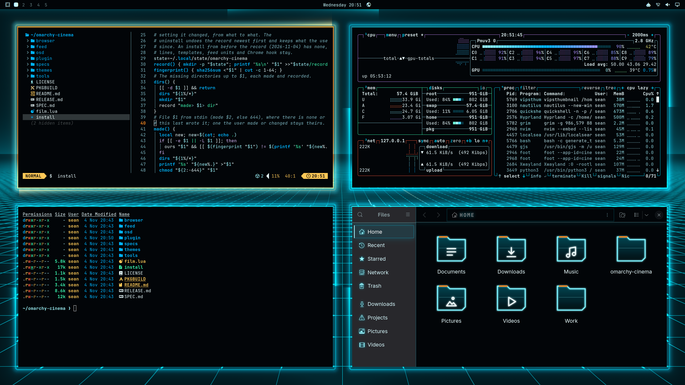

# Tron Legacy

The Grid. A floor of light lines runs out to the horizon under a black sky, and light cycles race along it, trailing light. Around every window a circuit line is drawn, and pulses run along it; around the focused window they run orange, as Clu's do. The windows stand on the Grid, lit from the horizon behind them.

An [Omarchy](https://omarchy.org) theme from [Omarchy Cinema](https://github.com/seankd3/omarchy-cinema). On its
own it is a whole Omarchy theme with its film as the wallpaper. With the
Omarchy Cinema engine installed, the film comes alive: it is drawn around your
windows in the same frame as them, windows turn to glass with their text kept
solid, and Files, its folders and the dictation popup take its look.

    omarchy theme install https://github.com/seankd3/omarchy-tron-legacy-theme

[Try it in the browser](https://seankd3.github.io/omarchy-cinema/play/?film=https://raw.githubusercontent.com/seankd3/omarchy-tron-legacy-theme/HEAD/) before you install it.

## Make your own

Press *Use this template* to start a film from this one. Change
`colors.toml`, write `backdrop.frag` against [the contract](https://seankd3.github.io/omarchy-cinema/play/contract.html),
watch it in the [playground](https://seankd3.github.io/omarchy-cinema/play/),
name your repo `omarchy-<name>-theme`, and give it the topic
`omarchy-cinema` to list it in the gallery.

This repo is built from `themes/tron-legacy` of [omarchy-cinema](https://github.com/seankd3/omarchy-cinema) by
`tools/theme-repo`; changes go there.

## Credits

A fan homage. The film and its marks belong to their owners; this theme is
not affiliated with or endorsed by them, and ships no film imagery: the
wallpaper is this theme's own `backdrop.frag`, drawn. MIT licence (LICENSE).
